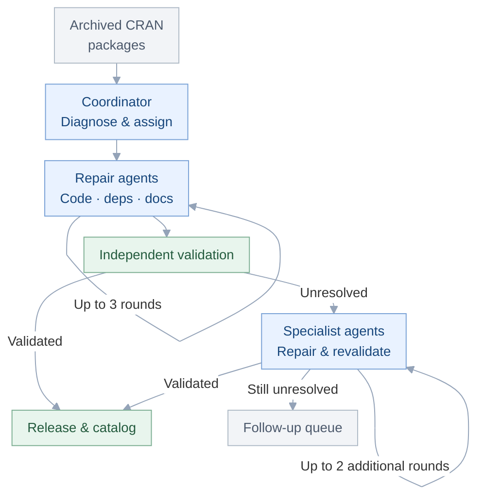

# Renova

[](https://renova-r.r-universe.dev/packages) [](https://github.com/orgs/renova-r/followers)

**Reproducible research needs living software.**

When CRAN packages fall out of maintenance, the science built on them goes dark. **Renova** is an autonomous multi-agent AI system that repairs and validates legacy R software. This public catalog showcases archived CRAN packages restored by the Renova engine and ready to install.

Project led by [Jing Jia](https://jjia131.github.io/), [Guanyang Wang](https://guanyangwang.github.io/), and [Peng Zhang](https://sites.google.com/site/pengzhang27182/).

Contact: [Jing Jia](mailto:jing.jia@rutgers.edu) · [Guanyang Wang](mailto:guanyang.wang@rutgers.edu).

Compute generously supported by [Open Math OS](https://www.openmathmodel.org/).

[Browse restored packages →](https://renova-r.r-universe.dev/packages)

## How Renova works

Renova coordinates specialized AI agents to restore archived CRAN packages. Agents diagnose problems, develop repairs, and validate results through an iterative workflow.

Examples include adapting code to newer R versions, fixing compilation and dependency problems, registering missing methods, and correcting documentation and package metadata.



## Install

Choose a package from the directory, then install it with:

```r
install.packages("PACKAGE", repos = c(
  Renova = "https://renova-r.r-universe.dev",
  CRAN = "https://cloud.r-project.org"
))
```
